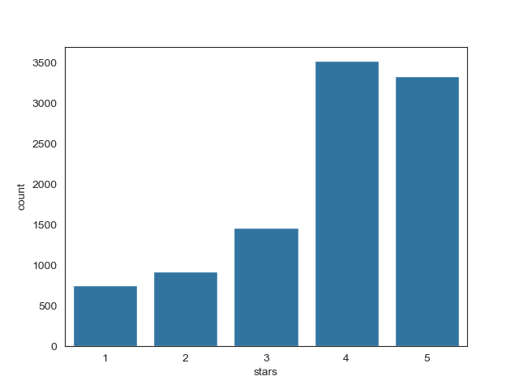
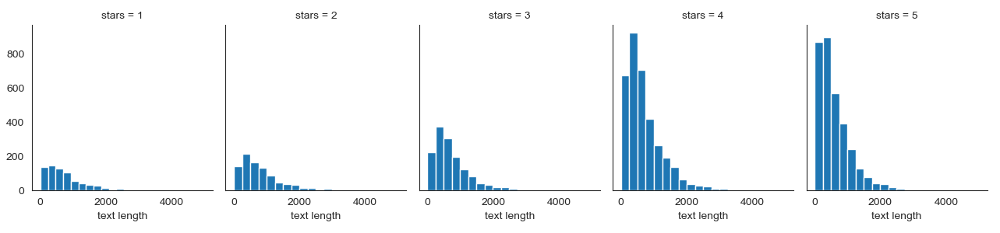
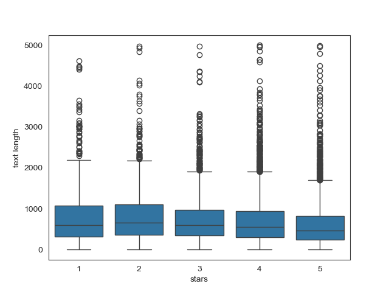
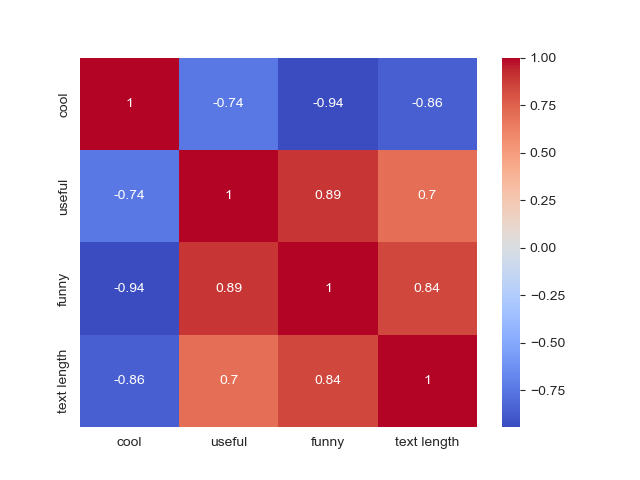

# Yelp Review Classifier

A text classification project that predicts whether a Yelp review is **1-star** or **5-star** from the review text alone, using classic NLP techniques and scikit-learn.

The project also compares two ways of turning text into features, **Bag-of-Words (CountVectorizer)** and **TF-IDF**, and shows why adding TF-IDF in a scikit-learn pipeline actually broke the Naive Bayes model.

---

## Project Structure

```
Yelp_Review_Classifier/
├── yelp.csv             # Dataset (Yelp reviews)
├── data.py              # Loading, EDA, filtering, vectorization, train/test split
├── train.py             # Model training and evaluation
├── main.py              # Entry point: runs the full pipeline
├── requirements.txt     # Python dependencies
├── images/              # Saved EDA plots used in this README
└── README.md
```

---

## Dataset

- **Source:** Yelp review dataset (`yelp.csv`, ~10,000 reviews)
- **Key columns:** `text` (review), `stars` (1–5 rating), plus `cool`, `useful`, `funny` vote counts
- **Filtered to:** only 1-star and 5-star reviews, to frame the task as a clear binary classification of very negative vs very positive reviews

---

## Approach

### 1. Exploratory Data Analysis
- Added a `text length` feature (number of characters per review)
- Plotted the text length distribution across star ratings
- Grouped by `stars` and computed mean `cool`, `useful`, `funny` and `text length`
- Built a correlation matrix of these features

#### EDA Visualizations

**Number of reviews per star rating**



Most reviews are 4 or 5 stars. After filtering to 1 and 5 stars, 5-star reviews outnumber 1-star reviews about 4 to 1, a class imbalance that matters later in modeling.

**Text length distribution by star rating**





Review length is similar across ratings, with 5-star reviews slightly shorter on average. Text length alone is not a strong predictor of rating.

**Correlation between review features (averaged per star rating)**



`funny` and `useful` votes are strongly positively correlated with each other and with text length, while `cool` votes move in the opposite direction.

### 2. Preprocessing
- Kept only 1-star and 5-star reviews
- Converted text into numeric features with:
  - **CountVectorizer** (raw word counts)
  - **TF-IDF** (term frequency × inverse document frequency)

### 3. Modeling
- **Baseline:** CountVectorizer + Multinomial Naive Bayes
- **Pipeline:** scikit-learn `Pipeline` combining CountVectorizer → TF-IDF → Multinomial Naive Bayes
- 70 / 30 train-test split (`random_state=101`)
- Evaluated with a confusion matrix and classification report (precision, recall, F1)

---

## Results

| Model                                   | Accuracy | 1-star F1 | 5-star F1 |
|-----------------------------------------|----------|-----------|-----------|
| Baseline: CountVectorizer + NB          | **93%**  | **0.78**  | **0.96**  |
| Pipeline: CountVectorizer + TF-IDF + NB | 81%      | 0.00      | 0.90      |

```
Confusion matrix: Baseline (CountVectorizer + NB)
[[159  69]     <- 159 of 228 one-star reviews correctly identified
 [ 22 976]]    <- 976 of 998 five-star reviews correctly identified

Confusion matrix: Pipeline (CountVectorizer + TF-IDF + NB)
[[  0 228]     <- every one-star review predicted as 5-star
 [  0 998]]    <- every five-star review predicted as 5-star
```

**Key finding:** adding TF-IDF made the model *worse*. The TF-IDF pipeline predicted **5 stars for every single review**. Its 81% accuracy is simply the share of 5-star reviews in the test set (998 / 1226), so it learned nothing useful.

### Why TF-IDF hurt performance
- **Multinomial NB expects count data.** It models how often each word appears. TF-IDF replaces counts with small fractional weights that no longer fit that assumption.
- **The classes are imbalanced.** There are about 4× more 5-star than 1-star reviews. With TF-IDF's small, flattened feature values, the class prior dominated and the model always predicted the majority class.
- **Accuracy alone hides this.** 81% looks acceptable, but the 1-star F1 of 0.00 and the confusion matrix show the model is useless for detecting negative reviews.

---

## How to Run

### 1. Clone the repository
```bash
git clone https://github.com/LovelaceLoops/Yelp_Review_Classifier.git
cd Yelp_Review_Classifier
```

### 2. Install dependencies
```bash
pip install -r requirements.txt
```

### 3. Run the full pipeline
```bash
python main.py
```

`main.py` is the single entry point. It imports `data.py` (preprocessing) and then `train.py` (training and evaluation), so the whole project runs with one command.
You can also run each stage on its own:
```bash
python data.py    # EDA and preprocessing only
python train.py   # Training and evaluation
```

---

## Tech Stack

- **Python**
- **pandas, NumPy**: data handling
- **Matplotlib, Seaborn**: visualization
- **scikit-learn**: vectorization, TF-IDF, Pipeline, Naive Bayes, evaluation

---

## Future Improvements

- Pair TF-IDF with **Logistic Regression** or **LinearSVC**, models that suit TF-IDF better than NB
- Improve 1-star recall (currently 0.70)
- Handle class imbalance with `class_weight='balanced'` or resampling
- Remove English **stopwords** (NLTK) and compare results
- Add **bigrams** (`ngram_range=(1, 2)`) to capture phrases like "not good"
- Extend to all 5 star ratings (multi-class) or 3-class sentiment
- Try transformer models (e.g. DistilBERT) for comparison
- Save the trained model and vectorizer with `joblib` and serve predictions through a small Streamlit or Flask app

---

## What I Learned

- Debugging common pandas pitfalls (e.g. `groupby().mean()` on text columns in pandas 2.x, `df('col')` vs `df['col']`)
- Structuring an ML project as separate Python modules with a single `main.py` entry point
- Building a scikit-learn `Pipeline` that chains vectorization, TF-IDF and the classifier into one model
- That a more sophisticated feature (TF-IDF) is not automatically better, because the model and the feature representation have to fit each other
- Why per-class metrics matter more than accuracy on imbalanced data

---

## Author

**Mrunal Patil**: B.E. Computer Engineering (AI/ML), University of Mumbai